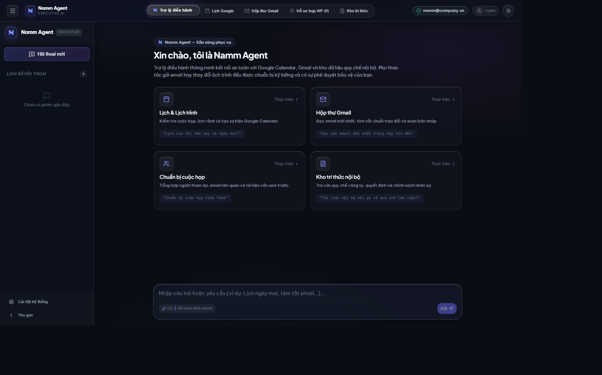
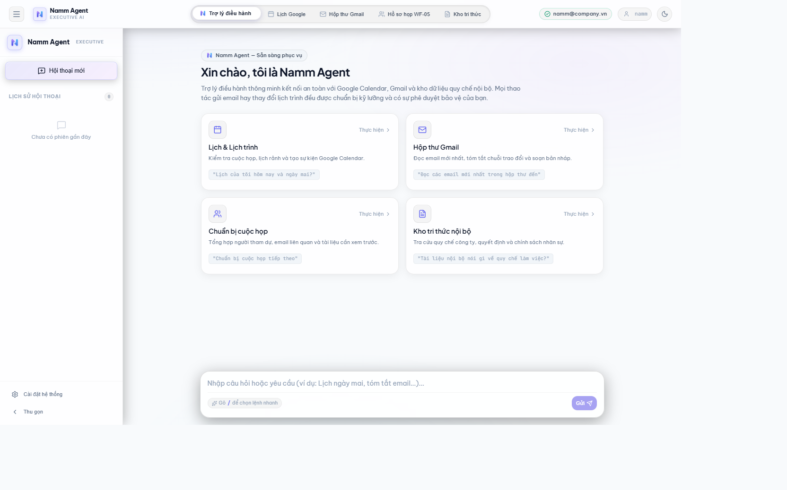
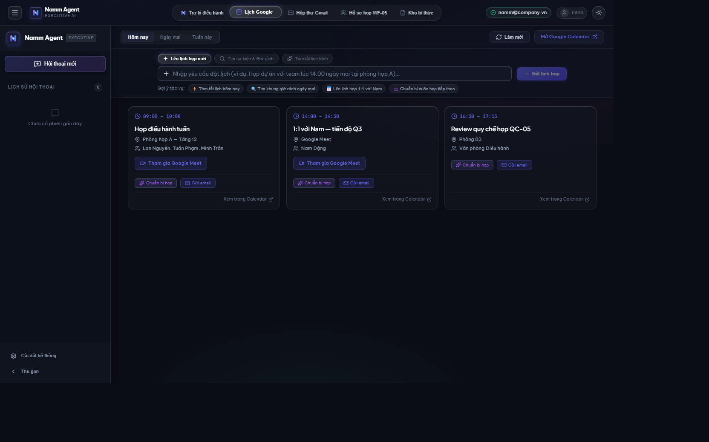
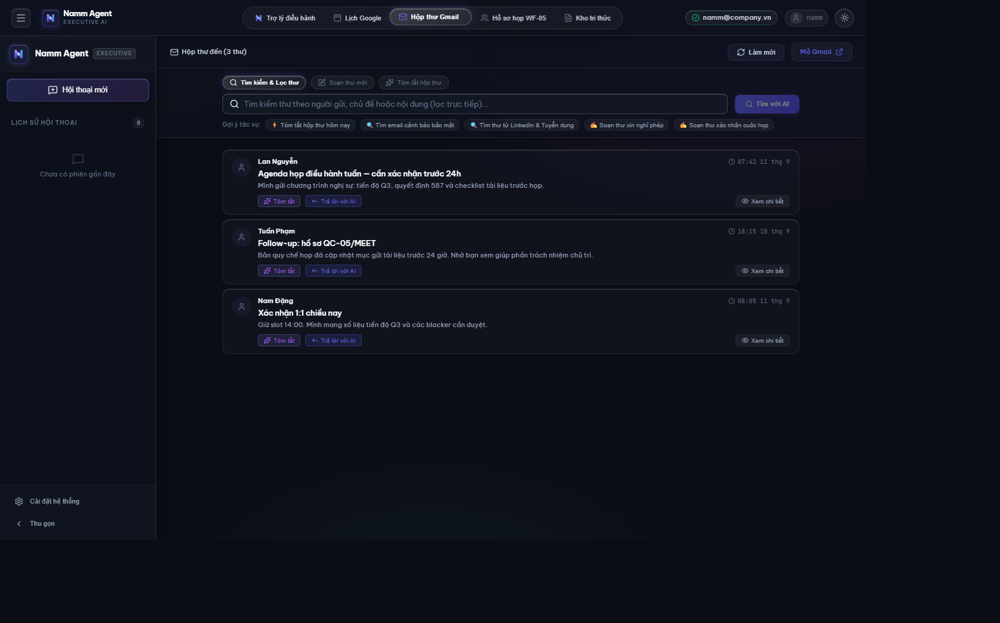
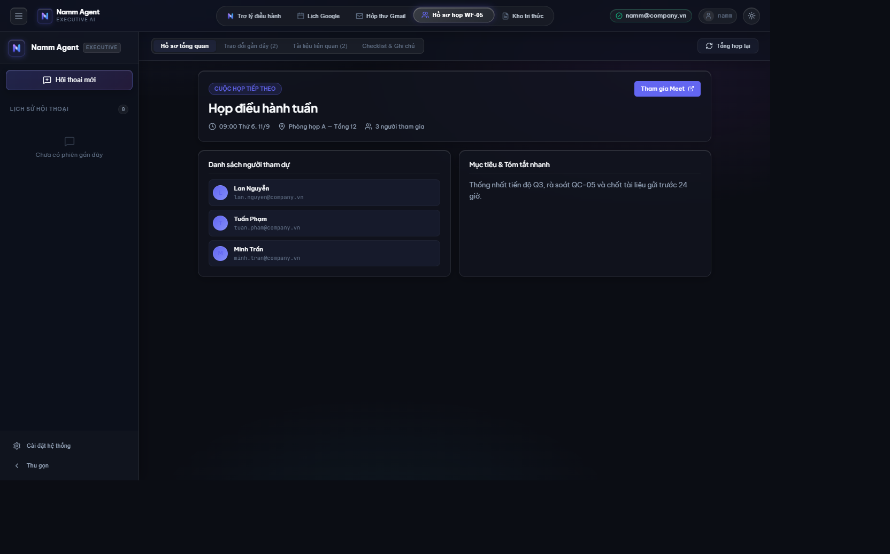
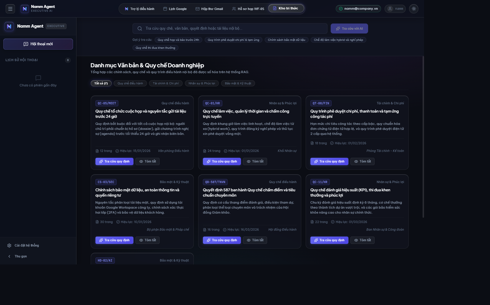
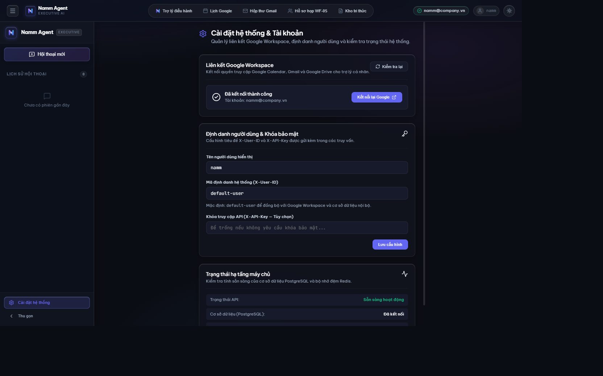

# Personal AI Assistant

A Vietnamese-speaking personal assistant that works across Google Workspace and your internal document library.

Ask about your calendar, read mail, look things up in documents, prepare for meetings, or write reports from existing material — in plain sentences, with no commands to remember. Read-only work happens right away. Anything that sends, schedules or deletes stops once for your approval.

## What it does

**Google Workspace**

- **Calendar** — view today, tomorrow or this week; book a meeting when you give a clear time.
- **Email** — read the inbox and filter by sender; draft follow-ups after a meeting. Every draft goes through an independent reviewer (placeholders, missing points, invented facts) and is fixed before you approve it. The assistant never guesses a recipient: when it is unclear it asks, then carries on with the same request once you answer.
- **Meeting prep** — gathers the event, attendees' mail and related documents into a short brief.
- **Google Drive** — find and read files; write operations (move, delete) only after you agree.
- **Tasks (Google Tasks)** — "việc cần làm?" (what's on my list?), "thêm việc: gọi anh Nam hạn thứ 6" (add a task with a due date), "xong việc gọi anh Nam" (mark it done). Adding and completing both go through an approval card; overdue and due tasks appear in the morning briefing. Accounts connected before this feature must press **Kết nối** (Connect) again to grant the Tasks scope.

**Proactive**

- **Morning briefing** — every morning (07:30 by default) it gathers today's events and the unread mail of the last 24 hours.
- **Automatic meeting prep** — about 30 minutes before each meeting with guests it builds a meeting brief (the guests' recent mail, related internal documents).
- **After the meeting** — when a meeting with guests ends it suggests "Soạn follow-up" (draft a follow-up); the draft still waits for your approval.
- **Important mail** — checks the inbox every few minutes and flags important new mail right away.
- **Meeting minutes** — when a Google Meet transcript (Transcript / Notes by Gemini) appears in Drive, it writes the minutes: key points, decisions, action items. To ask by hand: "biên bản cuộc họp hôm nay" (today's meeting minutes). Transcription must be enabled in Meet.
- Results show up under the **notification bell** in the header and are pushed to the browser as soon as they exist (SSE). The assistant only reads; it never sends or changes anything on its own.

**Long-term goals and watches**

- "Đặt mục tiêu: chuẩn bị hội thảo trước 15/12" (set a goal with a deadline) — the assistant splits it into dated steps and reminds you each morning when a step is due; "tiến độ mục tiêu" (goal progress), "xong bước 2 của mục tiêu hội thảo" (step 2 done).
- "Báo tôi khi nam@congty.vn trả lời" (tell me when someone replies), "theo dõi email có 'hợp đồng'" (watch mail containing a keyword), "báo khi có tài liệu mới về quy chế chi tiêu" (tell me about new documents on a topic) — the assistant only posts to the notification bell and takes no action; "đang theo dõi gì?" (what am I watching?), "dừng theo dõi …" (stop watching).

**Your own automations (skills)**

- "Tạo quy trình mỗi thứ 6 lúc 17h: tổng hợp email tuần này" (every Friday at 17:00, summarise this week's mail), "tạo quy trình ngày làm việc 7h: lịch hôm nay?" (every working day at 07:00, today's calendar) — the assistant runs exactly that request on schedule, as if you had asked it, and posts the result to the notification bell; anything that writes still waits for approval. "Các quy trình của tôi" (my automations), "xóa quy trình 2" (delete automation 2).

**Spreadsheet analysis**

- "Phân tích file Doanh thu 2026: tổng doanh thu theo khu vực" (analyse a sheet: revenue by region) — reads Google Sheets / Excel from Drive. The model only writes a *query plan* (filter, group, sum, count, sort); the system computes it and returns the table. No model-written code is executed.

**Long-term memory**

- Say "nhớ rằng chữ ký của tôi là …" (remember my signature is …), "quên số điện thoại cũ" (forget the old phone number), "bạn nhớ gì về tôi?" (what do you remember about me?) right in the chat.
- The assistant remembers only what you tell it to, and uses it when drafting mail (name, signature, tone).
- View, edit or delete each item under **Cài đặt → Bộ nhớ** (Settings → Memory).

**Web search**

- "Tìm trên web về …", "tra cứu trên mạng: …", "google: …", "tin tức …" (search the web / news) — answers from Tavily results, each point tagged with a source `[W1]` and its link.
- Only when you ask explicitly; questions about internal documents are never sent outside. Requires `TAVILY_API_KEY` (or `WEB_SEARCH__API_KEY`).

**Internal document library**

- **Answers with evidence** — every point cites the exact document, section and page; when the evidence is not enough it says what is missing.
- **Count, list, filter** — "có bao nhiêu quyết định năm 2025" (how many decisions in 2025), "văn bản mới nhất của …" (latest document from …) are answered from structured data, never by guessing numbers.
- **Relations between documents** — appointments, awards, replacements, legal bases… come from extracted relations and are rewritten into a natural answer.
- **Follow-up questions** — "trình bày chi tiết giai đoạn 3" (explain phase 3 in detail), "bước bấm Restore" (the step where you click Restore) are read in the context of the previous answer.
- **Figures and formulas** — screenshots and diagrams from a document appear right under the step they illustrate; formulas render as real math.
- **Reads** PDF (with a text layer or through OCR), DOCX, Markdown and Excel.

**Document generation**

- Reports, proposals, plans, minutes, official letters… from ingested documents: draft an outline → you edit and approve → each section is written → the result is self-reviewed and wrong sections are fixed.
- Excel tables filled per document (for example a list of decisions with number, date and signer).
- Export to `.docx` / `.xlsx`: formulas become Word equations, original figures come with captions, and figures and formulas are numbered by report section.

Things you can say:

- "Lịch ngày mai?" (tomorrow's calendar?)
- "Đọc email mới nhất từ anh Nam" (read the latest mail from Nam)
- "Trong các tài liệu có những quyết định bổ nhiệm nào?" (which appointment decisions are in the documents?)
- "Hướng dẫn tôi sao lưu bản quyền Windows bằng Dism++" (walk me through backing up a Windows licence with Dism++)
- "Viết báo cáo tổng hợp các công nghệ dùng trong đồ án TechConsult" (write a report on the technologies used in the TechConsult project)
- "Chuẩn bị họp ngày mai với Nam" (prepare tomorrow's meeting with Nam)

## Interface

The **Noat** web app (React) — ask in plain sentences, view the calendar and Gmail, prepare meetings, search and generate documents, approve write actions. Dark and light themes. The interface is in Vietnamese.





| Google Calendar | Gmail inbox |
|---|---|
|  |  |

| Meeting briefs | Knowledge base |
|---|---|
|  |  |



## How it works

**Routing.** A single-task, single-source question is handled directly; repeated jobs (meeting prep) follow a fixed workflow; work that spans several sources is planned first and then executed. Document questions are split by the shape of the answer: numbers and lists come from SQL, relations from the relation table, content from search.

**Ingestion.** Each file is parsed into a section tree (Docling or PyMuPDF; Excel with openpyxl), then:

- a document *profile* (type, number, date, issuing body, signer…) is built with rules, calling the LLM only when ambiguous;
- *relations* between documents and people or units are extracted;
- formulas are rebuilt as LaTeX from the PDF text layer;
- images are stored (by hash, each image once) and described by a vision model, keeping the original label such as "Hình 4.3" (Figure 4.3) when present;
- sections are split into parent/child chunks and embedded with Vietnamese vectors in PostgreSQL (pgvector + full-text).

**Answering.** Hybrid dense + sparse search, rank fusion, evidence packing within a budget, a sufficiency check, then synthesis with citation labels `[E1]…`. The model only sees image *descriptions* and places `[Hình N]` (figure N) under the step it illustrates; the system swaps in the real image (only images that are part of the evidence). The evidence of each turn is stored server-side for tracing.

**Safety.** Every write action — creating, editing or deleting events, sending or deleting mail, changing files on Drive — needs your confirmation; approval tokens are single-use. Document content is wrapped in a prompt-injection boundary. Data and conversations are isolated per account.

## Repository layout

```
app/
  main.py             FastAPI factory: middleware, error handlers, routers (all mounted at the root path)
  api/
    routes/           one router per area: query (+SSE), conversations, runs (evidence), documents,
                      approvals, questions, notifications (+SSE), memories, tasks, telegram,
                      auth, google_auth (OAuth), health
    dependencies/     request identity: session token, or API key + X-User-ID
  core/               configuration (settings/), logging, security, LLM calls, images, text/JSON utilities
  domain/
    models/           plain data models (Pydantic), grouped by area
    enums/, errors/   shared enums and the AppError hierarchy
  infrastructure/
    db/               SQLAlchemy models/, sessions, repositories
    redis/            shared Redis client (health probe, run-budget reservations)
  services/
    routing/          triage and the QueryOrchestrator (query/ and its sub-packages)
    retrieval/        search/ → evidence/ → answer/, plus metadata/ and relations/
    ingestion/        parsing/, profiling/, relations/, chunking/, enrichment/, maintenance/
    documents/        templates, writing/, tables/, rendering/ (docx, xlsx, markdown)
    proactive/        background workers and their jobs: briefing, meeting prep, notifications
    google/, workflows/, approvals/, context/, telegram/, …   integrations, workflows, approvals, memory
  agents/, harness/, tools/, integrations/        specialist agents, supervisor graph, tools, API clients
  mcp/                MCP server exposing the assistant to other agents
frontend/src/
  components/workspaces/   assistant, calendar, email, meetings, settings,
                           documents/ (document generation), knowledge/ (knowledge base)
  hooks/                   useQueryStream, useConversations
scripts/
  ingestion/   ingest_corpus, inspect_ingestion, ocr_batch, ocr_vl/, export_corpus_md, make_parsing_fixtures
  backfill/    backfill_profiles, backfill_relations, backfill_formulas
  benchmarks/  eval_rag, eval_agent, hardening_report, benchmark_*
  create_admin.py, mcp_server.py
alembic/       database migrations
tests/         unit/ (mirrors app/), integration/ (skip without Postgres), e2e/, evaluation/, fixtures/
```

## Running locally

You need **Python 3.11–3.14** with [uv](https://docs.astral.sh/uv/), **Docker** (Postgres + Redis + backend + frontend; on Windows inside WSL), **Node 22** if you change the frontend, and an **OpenAI-compatible LLM gateway** (the project uses 9router). A Google OAuth client is only needed for real calendar/mail/Drive access.

```bash
uv sync --extra dev
cp .env.example .env
```

Fill in `.env`:

- `SECURITY__API_KEY`, `SECURITY__APPROVAL_SIGNING_KEY` (at least 32 characters)
- passwords for `POSTGRES_*` and `REDIS_PASSWORD`
- the LLM gateway: `ROUTER_BASE_URL`, `ROUTER_API_KEY`, `ROUTER_MODEL` (the model must accept images so it can describe figures during ingestion)
- for Google: `GOOGLE_CLIENT_ID`, `GOOGLE_CLIENT_SECRET`, and `GOOGLE__POST_CONNECT_URL` (where the browser lands after connecting; defaults to the local frontend)
- `SECURITY__ALLOW_REGISTRATION`: whether `POST /auth/register` is open. Unset, it is open only in development/testing; staging and production create accounts with `scripts/create_admin.py`

Optional settings for the proactive features (all have defaults): `PROACTIVE__ENABLED`, `PROACTIVE__BRIEFING_TIME` (for example `07:30`), `PROACTIVE__MEETING_PREP_LEAD_MINUTES`, `PROACTIVE__TIMEZONE`.

Never commit `.env`.

Start the stack (the backend runs `alembic upgrade head` on startup):

```bash
docker compose up -d
```

Create the admin account (the password is read from the environment or prompted for, never stored in code):

```bash
ADMIN_EMAIL=admin@example.com uv run python scripts/create_admin.py
```

- Health check: `GET http://127.0.0.1:8000/health`
- API docs: `http://127.0.0.1:8000/api/v1/docs`
- Web app: `http://localhost:5173`

Frontend development outside Docker (Vite, proxying the API to the backend):

```bash
cd frontend
npm install
npm run dev
```

The backend mounts `./app`, so after a Python change `docker restart assistant_backend` is enough. After rebuilding images, clear the build cache so the WSL disk does not grow: `docker builder prune -af`.

## Connecting Google

Sign in at `http://localhost:5173` and press **Kết nối** (Connect) in the header or in **Cài đặt** (Settings). Google asks for Calendar / Gmail / Drive / Contacts access and sends you back to the app.

## Telegram

Create a bot with @BotFather, set `TELEGRAM__BOT_TOKEN` (and `TELEGRAM__BOT_USERNAME`) in `.env`, and restart the backend. In the app open **Cài đặt → Telegram → Tạo mã liên kết** (Settings → Telegram → Create link code), then send `/link <code>` to the bot (the code is single-use and expires after 10 minutes). From then on, ask exactly as in the app; actions that need approval get **Duyệt / Từ chối** (Approve / Reject) buttons, and notifications (morning briefing, meeting briefs…) are delivered to the chat. The bot uses long polling, so no public address is needed. Note that Telegram conversations pass through Telegram's servers.

## MCP (using the assistant from Claude Desktop and other agents)

`scripts/mcp_server.py` is a stdio MCP server with the tools `ask_assistant`, `list_notifications`, `list_memories` and `remember`. It calls the assistant's API with your login token (`NOAT_TOKEN`, or `NOAT_API_KEY` + `NOAT_USER_ID`), so every permission and safety check still applies. There is no approval tool: write actions proposed by another agent must still be approved by you in the app or in Telegram. A sample Claude Desktop configuration sits at the top of the script.

## Ingesting documents

Put files under `data/<folder>/` (this directory is never committed) and ingest them. Run inside the backend container to use the GPU (stop the backend first to free its memory):

```bash
docker stop assistant_backend
docker compose run --rm --no-deps --entrypoint /app/.venv/bin/python \
  -v "$PWD/data:/app/data" -v "$PWD/scripts:/app/scripts" \
  backend scripts/ingestion/ingest_corpus.py --root data/DoAn
docker start assistant_backend
```

- `--root` takes a folder or a single file.
- `--force` re-ingests unchanged files too (creates a new version; use it after changing the parser).
- `--no-llm-profile` uses rules only, without calling the LLM.

Refresh ingested data without parsing or embedding again:

```bash
uv run python scripts/backfill/backfill_profiles.py     # --all: every document; --no-llm: rules only
uv run python scripts/backfill/backfill_relations.py
uv run python scripts/backfill/backfill_formulas.py
```

Each script has `--dry-run` to preview without writing.

### Scanned PDFs (OCR)

Scanned (image-only) PDFs are processed **outside** the runtime, on a GPU machine, and the resulting Markdown is ingested. The `paddleocr_vl_1_6` engine uses the finetuned PaddleOCR-VL 1.6 checkpoint (round 11): a local transformers folder with `config.json`, `model.safetensors`, the `*_paddleocr_vl.py` code and the tokenizer. It reads pages the same way as the OCR webapp's scan path: PP-DocLayoutV2 (CPU) finds the blocks and reading order, the VL model reads each block with its own prompt (`OCR:`, `Table Recognition:`, `Formula Recognition:`), and the blocks are assembled into Markdown (HTML tables, `$$…$$` formulas). The code lives in `scripts/ingestion/ocr_vl/`.

Install into a separate venv, not the runtime one:

```bash
UV_PROJECT_ENVIRONMENT=~/.venvs/pai-ocr uv sync --frozen --python 3.12 --extra ocr-paddle   # or --extra ocr-surya
UV_PROJECT_ENVIRONMENT=~/.venvs/pai-ocr uv run --no-sync python scripts/ingestion/ocr_batch.py \
  --input-dir ./scanned_pdfs --output-dir ./parsed_md \
  --engine paddleocr_vl_1_6 --model-path /path/to/round11/ckpt --model-name round11 --device cuda:0
```

- `--model-path` is required (or set `OCR_VL_MODEL_PATH`). `--model-name` is only a readable label; it defaults to the checkpoint folder name.
- The `.ocr.json` sidecar records `engine_version` as `round11 sha256:dcdbc90e51ce; paddleocr 3.7.0; pipeline scan-v1`. The hash comes from the weight file, so switching checkpoints makes the next batch run OCR again and changes the ingestion fingerprint.
- Images, stamps and page margins (headers, footers, page numbers, footnotes) are left out of the Markdown; a table that spans two pages is merged into one.
- `--vram-gb` (default 5.5) caps the process's GPU memory, useful on a shared GPU. Ampere and newer GPUs run bf16; Turing (GTX 16xx, T4) runs fp16, as in the model's evaluation.
- On Windows, PyPI only ships CPU builds of torch. After syncing, reinstall the CUDA build of the same version, for example `uv pip install --python ~/.venvs/pai-ocr torch==2.13.0 torchvision==0.28.0 --index-url https://download.pytorch.org/whl/cu126 --reinstall-package torch --reinstall-package torchvision`.

Extracted images live in `storage/doc_images/` (also never committed) and are served through `GET /documents/images/{key}` only to users who can read a document that refers to them.

## Calling the API

Every question goes through `POST /query` (or `POST /query/stream` to receive tokens over SSE). Send a login token or `X-API-Key`:

```bash
curl -s http://127.0.0.1:8000/query \
  -H "Content-Type: application/json" \
  -H "Authorization: Bearer <token>" \
  -d '{"query": "Lịch ngày mai?"}'
```

When approval is needed, the response carries an `approval_id`:

```bash
curl -s -X POST "http://127.0.0.1:8000/approvals/<approval_id>/approve" \
  -H "Content-Type: application/json" \
  -H "Authorization: Bearer <token>" \
  -d '{"execute": true}'
```

Without `execute` you receive a single-use token; call `POST /approvals/<id>/execute` with it later.

Document generation: `POST /documents/outline` (outline) → `POST /documents/{id}/approve` (write) → `GET /documents/{id}/download` (`.docx` / `.xlsx`); rewrite one section from feedback with `POST /documents/{id}/sections/{index}/rewrite`.

## Development

```bash
uv run pytest                 # unit + integration (integration tests skip themselves without Postgres)
uv run ruff check app tests scripts
uv run ruff format --check app tests scripts
uv run pyright
cd frontend && npx tsc -p tsconfig.app.json --noEmit && npx oxlint src && npm run build
```

Measure answer quality on the reference question set (needs the backend and an LLM): `uv run python scripts/benchmarks/eval_rag.py`.

Measure agent behaviour (routing, blocking writes, asking mid-task, memory, resisting injected instructions in mail, tasks, web) on the reference scenario set, offline with no backend or LLM: `uv run python scripts/benchmarks/eval_agent.py`. The same suite also runs in pytest.

Find ReAct flows stable enough to harden into static graphs (≥ 50 turns, ≥ 90% following the same tool sequence), as described in `docs/architecture/loop-vs-graph.md`: `uv run python scripts/benchmarks/hardening_report.py`.

Coding conventions and every CI step to run before a push (lint, types, tests + coverage, secret scanning, dependency vulnerabilities, bandit, Trivy) are in [AGENTS.md](AGENTS.md). GitHub also runs CodeQL and Dependabot.

## Stack

FastAPI · React (Vite) · PostgreSQL 16 + pgvector · Redis 7 · Docling / PyMuPDF / openpyxl · Vietnamese embedding and reranking · Google Calendar / Gmail / Drive / Tasks · temml (MathML) · python-docx (OMML equations).
