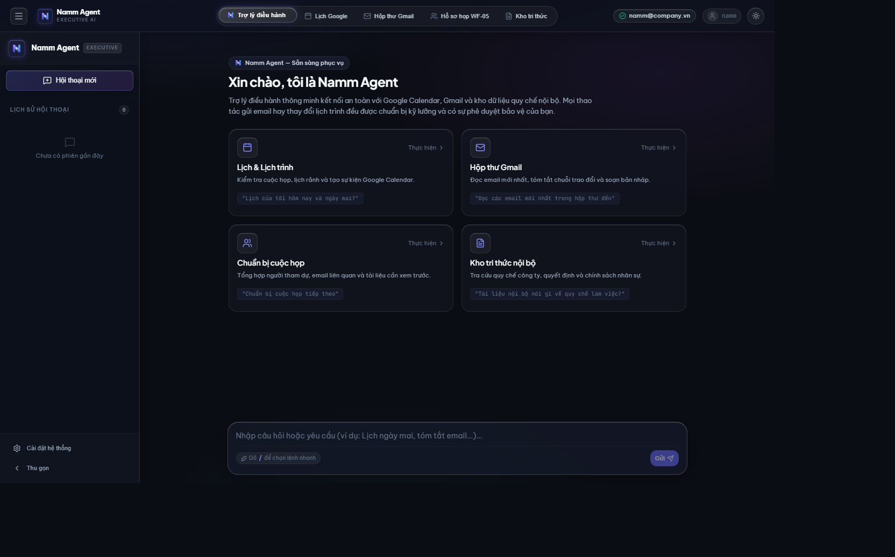
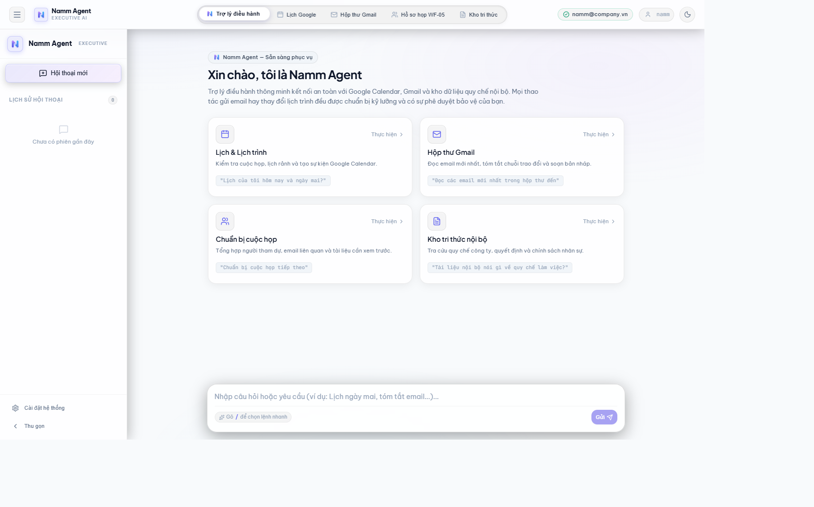
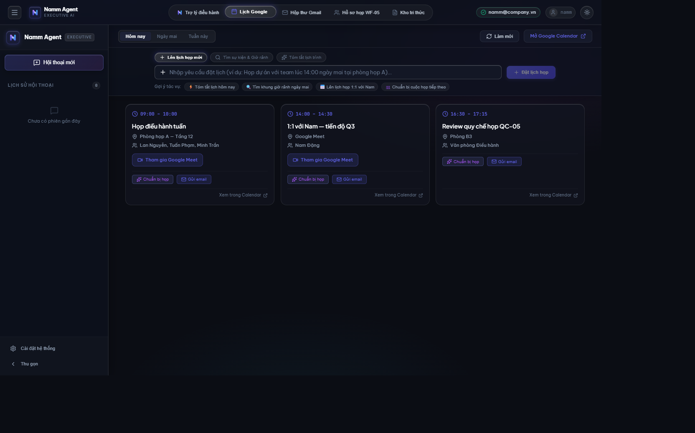
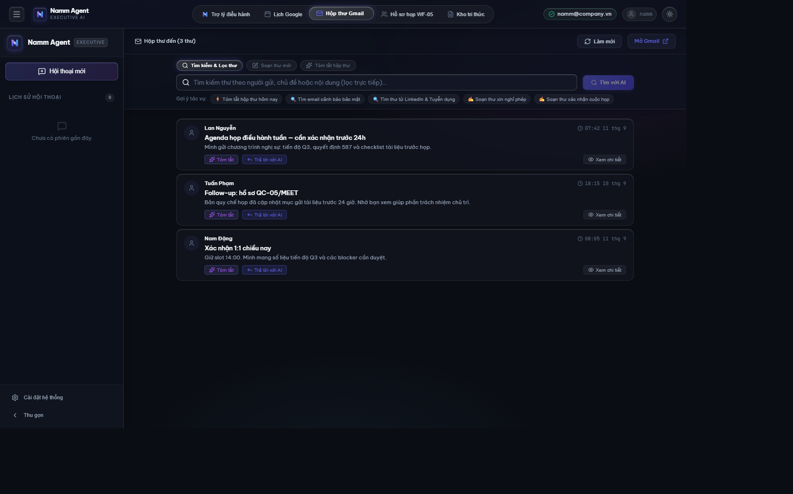
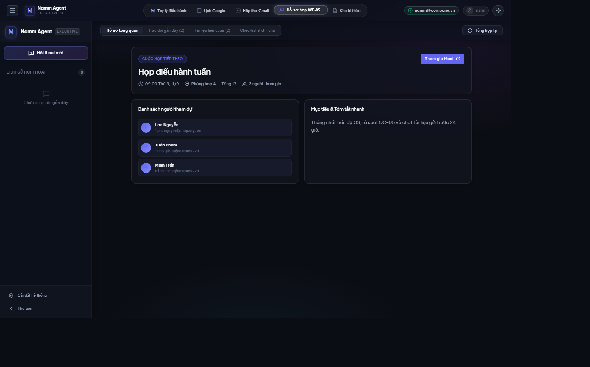
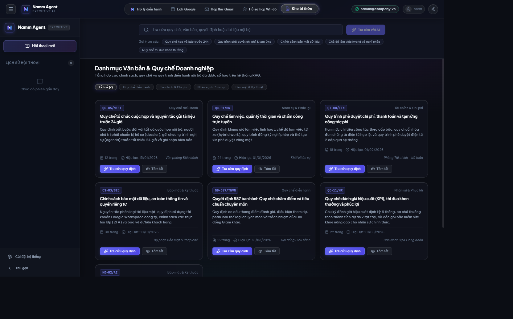
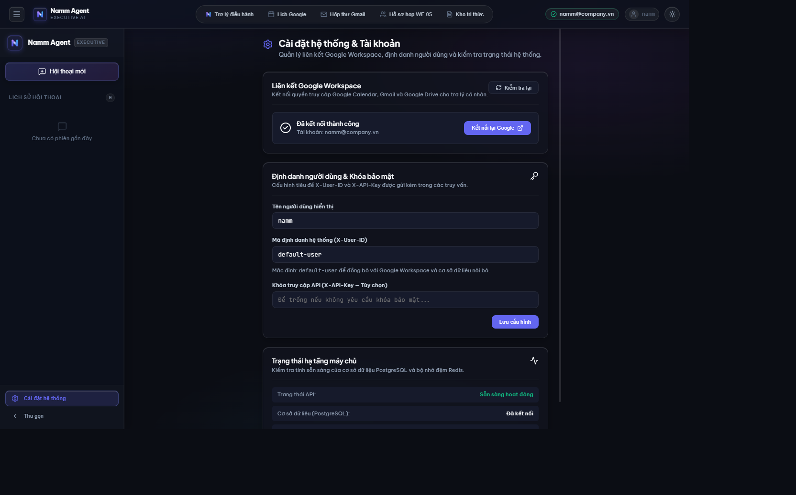

# Personal AI Assistant

Trợ lý cá nhân nói tiếng Việt, làm việc trên Google Workspace và kho tài liệu nội bộ của bạn.

Hỏi lịch, đọc mail, tra văn bản, chuẩn bị họp, viết báo cáo từ tài liệu có sẵn — bằng câu thường, không cần nhớ lệnh. Việc chỉ đọc thì trợ lý làm luôn. Việc gửi đi, đặt lịch hay xóa thì dừng lại để bạn duyệt một lần.

## Làm được gì

**Google Workspace**

- **Lịch** — xem hôm nay, ngày mai, tuần này; đặt cuộc họp khi bạn nói rõ giờ.
- **Email** — đọc hộp thư, lọc theo người gửi; soạn nháp follow-up sau cuộc họp.
- **Chuẩn bị họp** — gom lịch, mail khách mời và tài liệu liên quan thành một hồ sơ ngắn.
- **Google Drive** — tìm và đọc file; thao tác ghi (chuyển, xóa) chỉ sau khi bạn đồng ý.

**Kho tài liệu nội bộ**

- **Trả lời có dẫn chứng** — mỗi ý gắn trích dẫn tới đúng văn bản, mục và trang; không đủ căn cứ thì nói rõ thiếu gì.
- **Đếm, liệt kê, lọc** — «có bao nhiêu quyết định năm 2025», «văn bản mới nhất của …» trả lời từ dữ liệu có cấu trúc, không đoán số.
- **Quan hệ giữa văn bản** — bổ nhiệm, khen thưởng, thay thế, căn cứ… lấy từ quan hệ đã trích xuất, rồi viết lại thành câu trả lời tự nhiên.
- **Hỏi tiếp** — «trình bày chi tiết giai đoạn 3», «bước bấm Restore» được hiểu theo câu trả lời trước.
- **Hình và công thức** — ảnh chụp màn hình, sơ đồ của tài liệu hiện ngay dưới bước tương ứng; công thức hiển thị như công thức toán thật.
- **Đọc được** PDF (có lớp chữ hoặc qua OCR), DOCX, Markdown và Excel.

**Tạo tài liệu**

- Báo cáo, tờ trình, kế hoạch, biên bản, công văn… từ các văn bản đã nạp: lập dàn ý → bạn sửa và duyệt → viết từng mục → tự rà soát và sửa mục sai.
- Bảng Excel điền theo từng văn bản (ví dụ danh sách quyết định với số hiệu, ngày, người ký).
- Xuất `.docx` / `.xlsx`: công thức là công thức Word, hình gốc kèm chú thích, hình và công thức đánh số theo mục của báo cáo.

Ví dụ bạn có thể nói:

- «Lịch ngày mai?»
- «Đọc email mới nhất từ anh Nam»
- «Trong các tài liệu có những quyết định bổ nhiệm nào?»
- «Hướng dẫn tôi sao lưu bản quyền Windows bằng Dism++»
- «Viết báo cáo tổng hợp các công nghệ dùng trong đồ án TechConsult»
- «Chuẩn bị họp ngày mai với Nam»

## Giao diện

Ứng dụng web **Noat** (React) — hỏi bằng câu thường, xem lịch và Gmail, chuẩn bị họp, tra cứu và tạo tài liệu, duyệt hành động ghi. Có chế độ tối và sáng.





| Lịch Google | Hộp thư Gmail |
|---|---|
|  |  |

| Hồ sơ họp | Kho tri thức |
|---|---|
|  |  |



## Cách trợ lý làm việc

**Định tuyến.** Câu hỏi một việc, một nguồn được xử lý thẳng; việc lặp lại (chuẩn bị họp) chạy theo kịch bản cố định; việc lan sang nhiều nguồn được lập kế hoạch rồi mới làm. Câu hỏi về tài liệu được chia theo hình dạng câu trả lời: con số và danh sách lấy từ SQL, quan hệ lấy từ bảng quan hệ, nội dung lấy từ tìm kiếm.

**Nạp tài liệu.** Mỗi file được phân tích thành cây mục (Docling hoặc PyMuPDF; Excel bằng openpyxl), rồi:

- lập *hồ sơ* văn bản (loại, số hiệu, ngày, cơ quan, người ký…) bằng luật, chỉ gọi LLM khi mơ hồ;
- trích *quan hệ* giữa văn bản và người, đơn vị;
- dựng lại công thức thành LaTeX từ lớp chữ PDF;
- lưu ảnh (theo mã băm, mỗi ảnh một lần) và nhờ mô hình thị giác mô tả từng ảnh, giữ nhãn gốc «Hình 4.3» khi có;
- chia mục cha/con và nhúng vector tiếng Việt vào PostgreSQL (pgvector + full-text).

**Trả lời.** Tìm lai dense + sparse, gộp thứ hạng, đóng gói bằng chứng theo ngân sách, kiểm tra đủ căn cứ, rồi tổng hợp với nhãn trích dẫn `[E1]…`. Mô hình chỉ thấy *mô tả* của ảnh và tự đặt `[Hình N]` dưới bước nó minh họa; hệ thống thay bằng ảnh thật (chỉ ảnh có trong bằng chứng). Bằng chứng mỗi lượt được lưu phía server để truy vết.

**An toàn.** Mọi hành động ghi — tạo/sửa/xóa lịch, gửi hay xóa mail, đổi file trên Drive — đều cần bạn xác nhận; token duyệt dùng một lần. Nội dung tài liệu được bọc trong ranh giới chống chèn lệnh. Dữ liệu và phiên hội thoại tách biệt theo từng tài khoản.

## Cấu trúc thư mục

```
app/
  api/routes/         HTTP: query (+SSE), conversations, documents, approvals, auth, health
  core/               cấu hình (settings/), logging, gọi LLM, ảnh, tiện ích văn bản
  domain/models/      mô hình dữ liệu thuần (Pydantic)
  infrastructure/db/  SQLAlchemy models/, phiên DB, repository
  services/
    routing/          triage và QueryOrchestrator (followup, knowledge, specialists, streaming)
    retrieval/        search/ → evidence/ → answer/, cùng metadata/ và relations/
    ingestion/        parsing/, profiling/, relations/, chunking/, enrichment/, maintenance/
    documents/        templates, writing/ (planner, writer, review, formulas, figures),
                      tables/, rendering/ (docx, xlsx, markdown)
    google/, workflows/, approvals/, context/ …   lịch, mail, Drive, kịch bản, duyệt, bộ nhớ
  agents/, harness/, tools/, integrations/        agent chuyên trách, supervisor, công cụ Google
frontend/src/
  components/workspaces/   assistant, calendar, email, meetings, settings,
                           documents/ (tạo tài liệu), knowledge/ (kho tri thức)
  hooks/                   useQueryStream, useConversations
scripts/
  ingestion/   ingest_corpus, inspect_ingestion, ocr_batch, export_corpus_md, make_parsing_fixtures
  backfill/    backfill_profiles, backfill_relations, backfill_formulas
  benchmarks/  eval_rag, benchmark_*
  create_admin.py
alembic/       migration CSDL
tests/         unit/ (theo cấu trúc app), integration/, evaluation/
```

## Chạy trên máy bạn

Cần **Python 3.11–3.14** với [uv](https://docs.astral.sh/uv/), **Docker** (Postgres + Redis + backend + frontend; trên Windows chạy trong WSL), **Node 20+** nếu sửa giao diện, và một **cổng LLM tương thích OpenAI** (dự án dùng 9router). Tài khoản Google OAuth chỉ cần khi muốn lịch/mail/Drive thật.

```bash
uv sync --extra dev
cp .env.example .env
```

Điền `.env`:

- `SECURITY__API_KEY`, `SECURITY__APPROVAL_SIGNING_KEY` (tối thiểu 32 ký tự)
- mật khẩu `POSTGRES_*`, `REDIS_PASSWORD`
- cổng LLM: `ROUTER_BASE_URL`, `ROUTER_API_KEY`, `ROUTER_MODEL` (mô hình cần đọc được ảnh để mô tả hình khi nạp tài liệu)
- nếu dùng Google: `GOOGLE_CLIENT_ID`, `GOOGLE_CLIENT_SECRET`

Không commit `.env`.

Khởi động (backend tự chạy `alembic upgrade head` khi lên):

```bash
docker compose up -d
```

Tạo tài khoản quản trị (mật khẩu đọc từ biến môi trường hoặc hỏi khi chạy, không nằm trong mã):

```bash
ADMIN_EMAIL=admin@example.com uv run python scripts/create_admin.py
```

- Kiểm tra sống: `GET http://127.0.0.1:8000/health`
- Tài liệu API: `http://127.0.0.1:8000/api/v1/docs`
- Giao diện: `http://localhost:5173`

Phát triển giao diện ngoài Docker (Vite, proxy API về backend):

```bash
cd frontend
npm install
npm run dev
```

Backend có mount `./app`, nên sau khi sửa mã Python chỉ cần `docker restart assistant_backend`. Sau khi build lại image, dọn cache để ổ đĩa WSL không phình: `docker builder prune -af`.

## Kết nối Google

Đăng nhập trên `http://localhost:5173`, bấm **Kết nối** trên thanh tiêu đề hoặc trong **Cài đặt**. Google hỏi quyền Lịch / Gmail / Drive / Danh bạ rồi đưa bạn trở lại ứng dụng.

## Nạp tài liệu

Đặt file vào `data/<thư mục>/` (thư mục này không được commit) rồi nạp. Chạy trong container backend để dùng GPU (dừng backend trước để nhường bộ nhớ):

```bash
docker stop assistant_backend
docker compose run --rm --no-deps --entrypoint /app/.venv/bin/python \
  -v "$PWD/data:/app/data" -v "$PWD/scripts:/app/scripts" \
  backend scripts/ingestion/ingest_corpus.py --root data/DoAn
docker start assistant_backend
```

- `--root` nhận một thư mục hoặc một file.
- `--force` nạp lại cả file không đổi (tạo phiên bản mới, dùng khi đổi bộ phân tích).
- `--no-llm-profile` chỉ dùng luật, không gọi LLM.

Cập nhật dữ liệu đã nạp mà không phân tích hay nhúng lại:

```bash
uv run python scripts/backfill/backfill_profiles.py     # --all: mọi văn bản; --no-llm: chỉ luật
uv run python scripts/backfill/backfill_relations.py
uv run python scripts/backfill/backfill_formulas.py
```

Mỗi script có `--dry-run` để xem trước mà không ghi.

PDF scan (ảnh) xử lý **ngoài** runtime, trên máy có GPU, rồi nạp file markdown:

```bash
uv pip install -e ".[ocr-paddle]"   # hoặc ".[ocr-surya]"
python scripts/ingestion/ocr_batch.py --input-dir ./scanned_pdfs --output-dir ./parsed_md \
  --engine paddleocr_vl_1_6 --device cuda:0
```

Ảnh trích ra nằm ở `storage/doc_images/` (cũng không commit), phục vụ qua `GET /documents/images/{key}` cho người có quyền đọc văn bản chứa ảnh.

## Gọi API

Mọi câu hỏi đi qua `POST /query` (hoặc `POST /query/stream` để nhận token theo SSE). Gửi kèm token đăng nhập hoặc `X-API-Key`:

```bash
curl -s http://127.0.0.1:8000/query \
  -H "Content-Type: application/json" \
  -H "Authorization: Bearer <token>" \
  -d '{"query": "Lịch ngày mai?"}'
```

Khi cần duyệt, phản hồi có `approval_id`:

```bash
curl -s -X POST "http://127.0.0.1:8000/approvals/<approval_id>/approve" \
  -H "Content-Type: application/json" \
  -H "Authorization: Bearer <token>" \
  -d '{"execute": true}'
```

Không gửi `execute` thì bạn nhận token dùng một lần; lần sau gọi `POST /approvals/<id>/execute` với token đó.

Tạo tài liệu: `POST /documents/outline` (dàn ý) → `POST /documents/{id}/approve` (viết) → `GET /documents/{id}/download` (`.docx` / `.xlsx`); viết lại một mục theo góp ý bằng `POST /documents/{id}/sections/{index}/rewrite`.

## Phát triển

```bash
uv run pytest                 # unit + integration (integration tự bỏ qua khi không có Postgres)
uv run ruff check .
uv run ruff format --check .
cd frontend && npx tsc -p tsconfig.app.json --noEmit && npx oxlint src && npm run build
```

Đo chất lượng trả lời trên bộ câu hỏi chuẩn (cần backend và LLM): `uv run python scripts/benchmarks/eval_rag.py`.

Quy ước viết code và toàn bộ các bước CI cần chạy trước khi push (lint, kiểu, test + coverage, quét secret, lỗ hổng thư viện, bandit, Trivy) nằm trong [AGENTS.md](AGENTS.md). Trên GitHub còn chạy CodeQL và Dependabot.

## Stack

FastAPI · React (Vite) · PostgreSQL 16 + pgvector · Redis 7 · Docling / PyMuPDF / openpyxl · embedding và rerank tiếng Việt · Google Calendar / Gmail / Drive · temml (MathML) · python-docx (công thức OMML).
